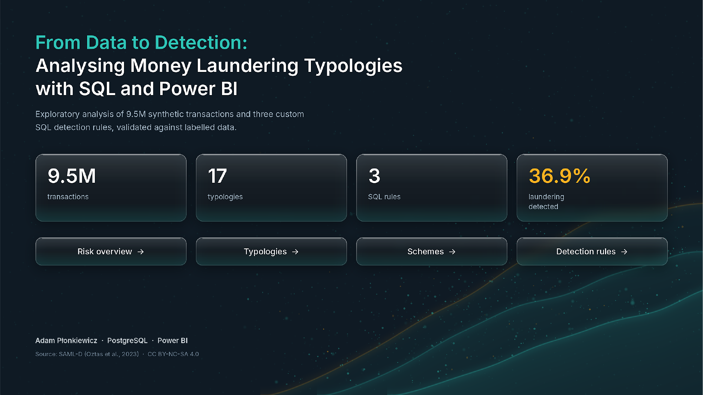
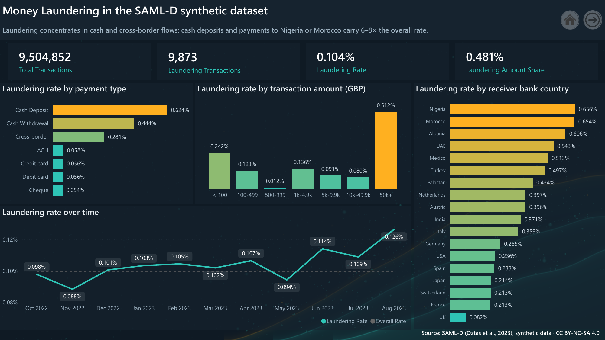
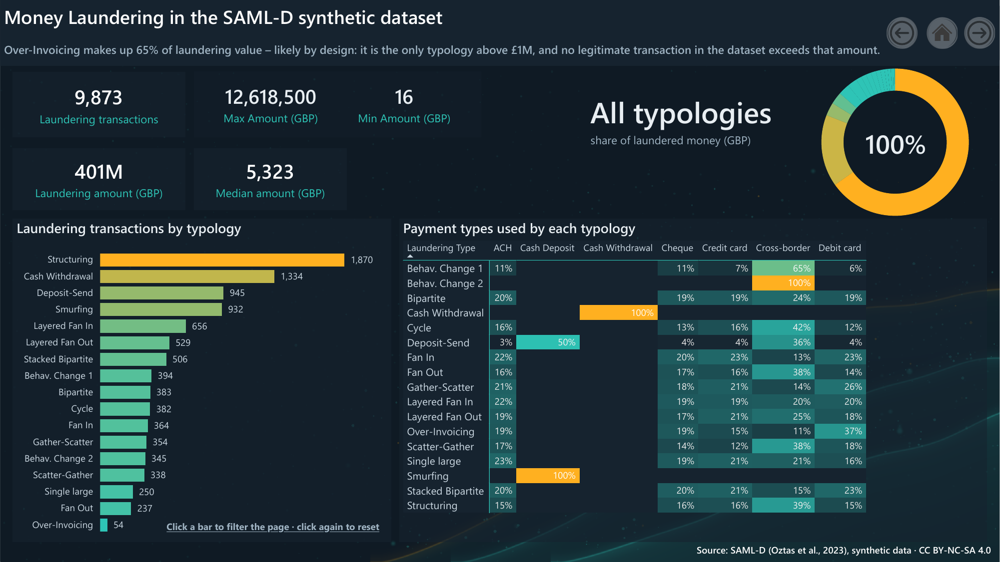
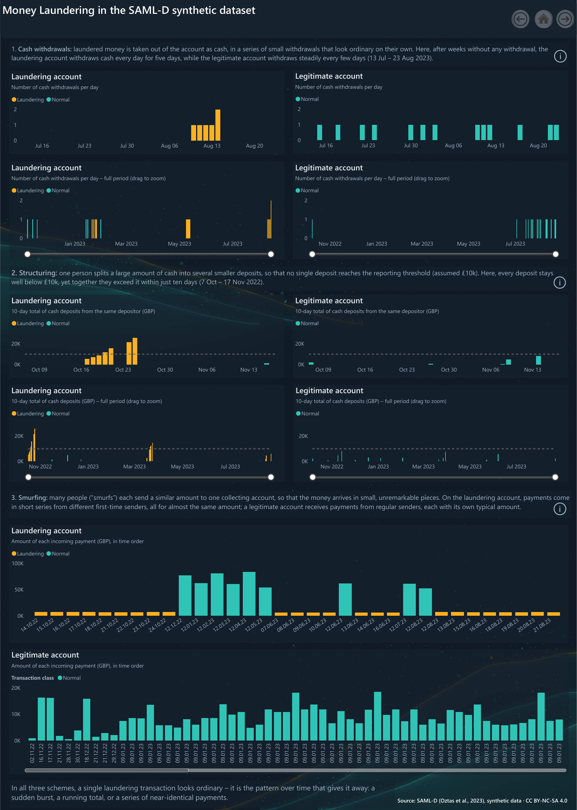
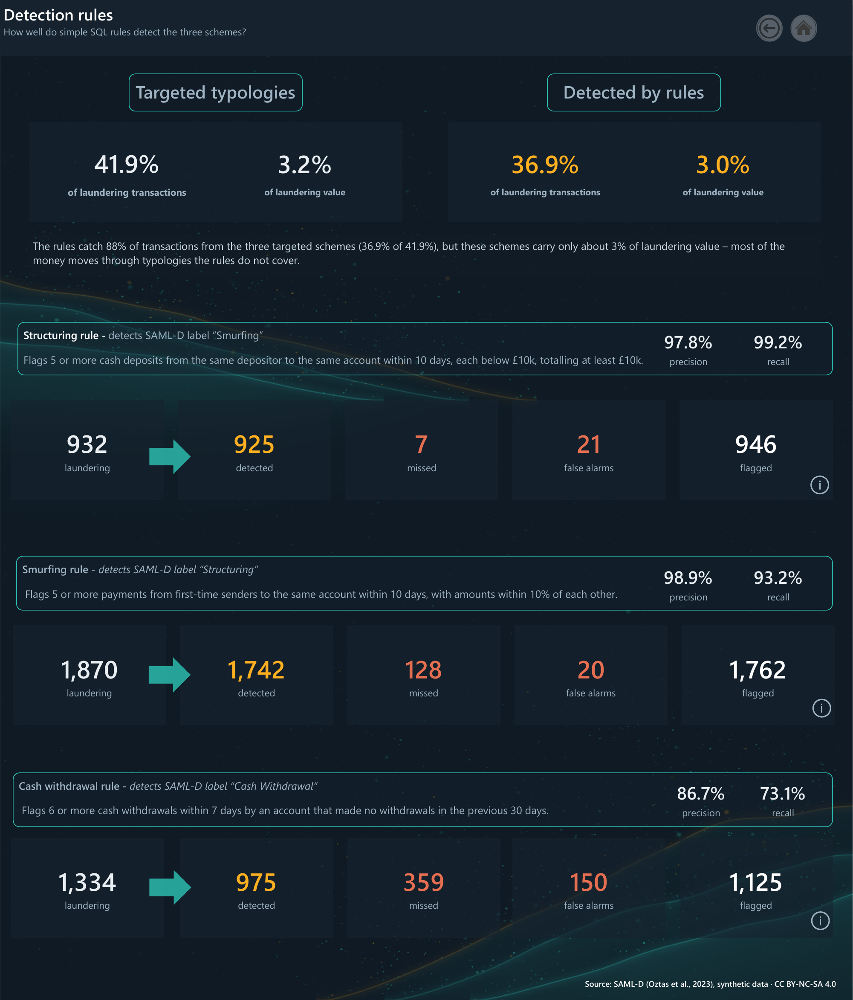

# From Data to Detection: Analysing Money Laundering Typologies with SQL and Power BI

*Exploratory analysis of 9.5M synthetic transactions and three custom SQL detection rules, validated against labelled data.*

## Overview

This project explores a synthetic anti-money laundering (AML) dataset of 9.5 million bank transactions. It answers three questions:

1. **Where does laundering occur?** Which channels, countries and amounts carry the highest risk.
2. **What do laundering schemes look like in the data?** How three common schemes differ from legitimate activity over time.
3. **Can simple rules detect them?** Three rule-based detection scenarios written in SQL, with thresholds chosen from the data and validated against the dataset labels.

The analysis was done in **PostgreSQL** (data profiling, exploration, detection rules) and presented in a **Power BI** dashboard.

## Key findings

- **Laundering is rare:** 0.104% of transactions (9,873 of 9.5M), but 0.481% of total value.
- **Risk concentrates in cash and cross-border flows:** cash deposits carry about 6× the overall laundering rate, and payments to Nigeria or Morocco about 8× the rate of domestic UK payments.
- **One typology dominates the money:** Over-Invoicing accounts for 65% of laundering value with only 54 transactions. Every transaction above £1M in the dataset belongs to it, and no legitimate transaction exceeds that amount, which is most likely a design choice of the data generator.
- **Two labels appear to be swapped:** the dataset label *Structuring* behaves like smurfing in AML literature, and *Smurfing* behaves like structuring (see [Label interpretation](#label-interpretation)).
- **Simple rules work well within their scope:** the three rules catch 88% of transactions from the schemes they target, with a combined precision of 95%. Those schemes, however, carry only about 3% of laundering value, so most of the money moves through typologies the rules do not cover.

## Dataset

**SAML-D** – Synthetic Anti-Money Laundering Dataset ([Kaggle](https://www.kaggle.com/datasets/berkanoztas/synthetic-transaction-monitoring-dataset-aml))

- 9,504,852 transactions, 7 Oct 2022 – 23 Aug 2023
- 12 columns: date and time, sender and receiver accounts, amount, currencies, bank locations, payment type, laundering flag and type
- 17 laundering typologies and 11 normal transaction types
- Synthetic data: no real customers or transactions

> Oztas, B., Cetinkaya, D., Adedoyin, F., Budka, M., Dogan, H., & Aksu, G. (2023). *Enhancing Anti-Money Laundering: Development of a Synthetic Transaction Monitoring Dataset.* IEEE International Conference on e-Business Engineering (ICEBE).

The dataset is licensed under **CC BY-NC-SA 4.0**. It is not included in this repository because of its size; download it from Kaggle to reproduce the analysis.

## Workflow

| File | Purpose |
|---|---|
| [`01_data_profiling_and_quality.sql`](sql/01_data_profiling_and_quality.sql) | Import check, missing values, duplicates, label consistency, amount distribution, account identifiers |
| [`02_clean_table_setup.sql`](sql/02_clean_table_setup.sql) | Working table: combined timestamp, unique account IDs, primary key, indexes |
| [`03_typology_exploration.sql`](sql/03_typology_exploration.sql) | Profiles of four typologies: senders, receivers, channels, amounts, series over time |
| [`04_rule_structuring.sql`](sql/04_rule_structuring.sql) | Structuring rule: threshold tests, final rule, validation |
| [`05_rule_cash_withdrawal.sql`](sql/05_rule_cash_withdrawal.sql) | Cash withdrawal rule: comparison with normal withdrawals, threshold tests, validation |
| [`06_rule_smurfing.sql`](sql/06_rule_smurfing.sql) | Smurfing rule: first-time senders, amount similarity, threshold tests, validation |
| [`07_dashboard_sample_accounts.sql`](sql/07_dashboard_sample_accounts.sql) | Selection of typical laundering and legitimate accounts for the dashboard |
| [`99_reporting_views.sql`](sql/99_reporting_views.sql) | Reporting views for Power BI: fact table with rule flags, sample account timelines |

**Data quality notes:** the raw data had no missing values, no duplicate rows and no inconsistencies between the laundering flag and type. Account numbers, however, are not unique across banks (affecting 17% of sender and 5.5% of receiver transactions), so each account is identified by its number plus bank location.

## Label interpretation

The full definitions used by the dataset authors are not public, so the shape of each typology was read from the data and compared with AML literature:

| SAML-D label | Behaviour in the data | Matches in literature |
|---|---|---|
| **Smurfing** | One sender → one account, cash deposits only, deposits of £1–7k, series of ~6 deposits in ~8 days totalling ~£18k | **Structuring** – one person splits cash into deposits below a reporting threshold |
| **Structuring** | Many senders → one account, each sender pays only once, no cash (mostly cross-border), near-identical amounts within a series | **Smurfing** – many people each pay a small amount into one collecting account |

The rules are named after the literature, and each rule states which SAML-D label it detects. This is an interpretation, not a confirmed fact about the dataset.

## Detection rules

| Rule | Logic | Flagged | Precision | Recall | Accounts detected |
|---|---|---|---|---|---|
| **Structuring** (label *Smurfing*) | 5+ cash deposits from the same depositor to one account within 10 days, each below £10k, totalling £10k or more | 946 | 97.8% | 99.2% | 63 / 63 |
| **Smurfing** (label *Structuring*) | 5+ payments from first-time senders to one account within 10 days, with amounts within 10% of each other | 1,762 | 98.9% | 93.2% | 75 / 75 |
| **Cash withdrawal** (label *Cash Withdrawal*) | 6+ cash withdrawals within 7 days by an account with no withdrawals in the previous 30 days | 1,125 | 86.7% | 73.1% | 77 / 88 |

Precision and recall are measured at transaction level against the dataset labels.

**Threshold choice.** Each threshold was compared with alternatives before being fixed. For example:
- Structuring: 4+ deposits caught all 63 accounts but raised 57 false pairs; 5+ deposits caught all 63 with only 4.
- Smurfing: counting first-time senders alone flagged about 15,000 normal receivers; adding the 10% amount condition removed almost all of them.
- Cash withdrawal: requiring 30 quiet days before a burst halved false pairs (46 → 25) while losing only one laundering account.

The **£10k reporting threshold is a working assumption** – the dataset does not define one.

## Dashboard

The Power BI report has a cover page and four pages. The full report is available as a [PDF](powerbi/aml_dashboard.pdf), and all DAX measures are in [`measures.dax`](powerbi/measures.dax).

**1. Risk overview** – how often laundering occurs and where the risk concentrates: by payment type, transaction amount, receiver country and month.

**2. Typologies** – how the 17 laundering typologies differ in volume, value and payment channels. Clicking a typology filters the page into a profile of that typology.

**3. Schemes** – three laundering accounts compared with legitimate accounts over time, each chart showing the signal its scheme leaves in the data: a burst of withdrawals, a running total of deposits, and a series of near-identical payments.

**4. Detection rules** – how many laundering transactions each rule catches, misses and wrongly flags.

### Interaction

<!-- Drag each MP4 file into the GitHub README editor and replace the lines below with the generated links. -->

**Filtering by typology**

VIDEO_LINK_1

**Exploring account timelines**

VIDEO_LINK_2

Data preparation in Power Query – typology names formatted for display:

## Skills demonstrated

- **SQL (PostgreSQL):** CTEs, window functions with time-based `RANGE` frames, `LAG` and `ROW_NUMBER`, self-joins, `FILTER` aggregates, percentiles, views and indexes
- **Analysis:** data quality checks, typology profiling, rule design, threshold testing, validation with precision and recall
- **Power BI:** data modelling, Power Query transformations, DAX measures (`CALCULATE`, `DIVIDE`, `SELECTEDVALUE`, `ALL`), interactive filtering, report design

## Limitations

- **Synthetic data:** patterns reflect the data generator, not real banking behaviour. The Over-Invoicing amount pattern and the one-day bursts of normal fan-in activity are likely generator features.
- **Label interpretation:** the swap of *Structuring* and *Smurfing* is inferred from the data, not confirmed by the dataset authors.
- **Assumed threshold:** the £10k reporting threshold is a working assumption.
- **Coverage:** the rules target 3 of 17 typologies. Fan-in and network typologies (cycles, layering, scatter-gather) would require analysis of money flows across accounts, which is outside the scope of this project.
- **End of data:** some laundering series are cut off on 23 Aug 2023 and cannot be detected by rules that require a full series.

## How to reproduce

1. Install PostgreSQL and download the SAML-D CSV from Kaggle.
2. Create the table `aml_transactions_raw` and import the CSV (amount as `NUMERIC(12,2)`).
3. Run the SQL files in order: `01` → `07`, then `99`.
4. In Power BI Desktop, connect to PostgreSQL (**Get data → PostgreSQL database**) and import `vw_fact_transactions` and `vw_sample_accounts`.

## Author

**Adam Płonkiewicz** – [LinkedIn](https://www.linkedin.com/in/adam-p%C5%82onkiewicz-762ab124a/)
